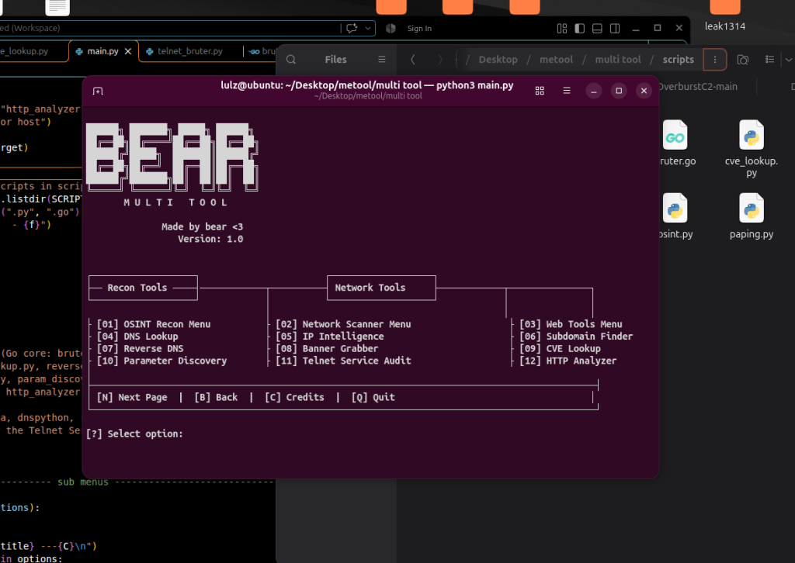
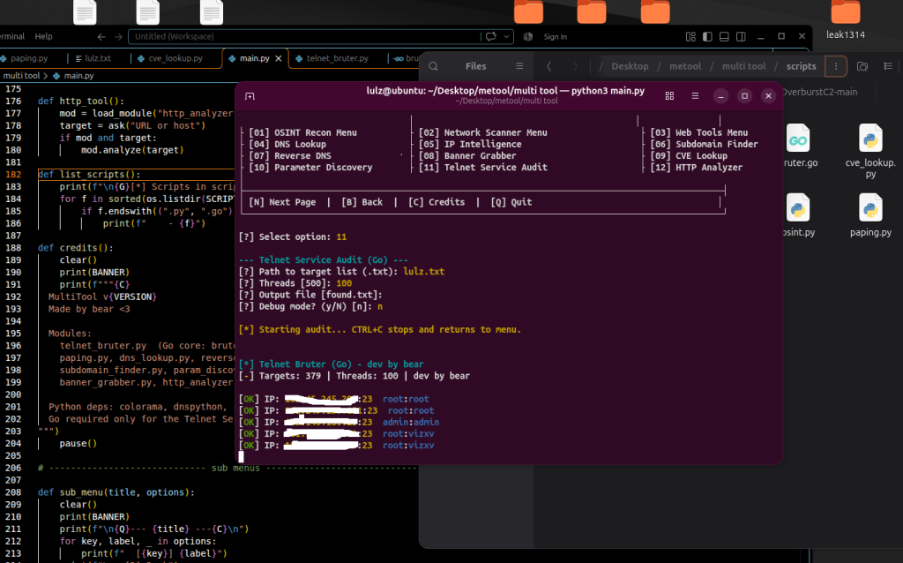

# BEAR MULTI TOOL

```text
██████╗ ███████╗ █████╗ ██████╗
██╔══██╗██╔════╝██╔══██╗██╔══██╗
██████╔╝█████╗  ███████║██████╔╝
██╔══██╗██╔══╝  ██║  ██║██║  ██║
██████╔╝███████╗██║  ██║██║  ██║
╚═════╝ ╚══════╝╚═╝  ╚═╝╚═╝  ╚═╝

          M U L T I   T O O L

              Made by bear <3
                 Version: 1.0
```

A multi-purpose Python security and network toolkit for reconnaissance, network inspection, web analysis, and authorized security testing.

## Features

```text
[x] OSINT Reconnaissance
[x] Network Scanner
[x] DNS Lookup
[x] IP Intelligence
[x] Reverse DNS Lookup
[x] Subdomain Finder
[x] Banner Grabber
[x] CVE Lookup
[x] Parameter Discovery
[x] Telnet Service Audit
[x] HTTP Analyzer
[x] TCP Ping (Paping)
[x] Multi-page Terminal Menu
```

## Menu Preview



The screenshot above shows the BEAR MULTI TOOL terminal interface.

## Tool Testing

### Telnet Service Audit



Tool 11 demonstrates Telnet service connectivity testing, connection status, and service banner inspection on authorized targets.

## Tools & Methods

```text
[Recon Tools]

[x] OSINT       | Open-source intelligence gathering
[x] GeoIP       | IP geolocation lookup
[x] DNS         | Domain DNS record lookup
[x] Reverse DNS | IP-to-hostname lookup
[x] Subdomain   | Passive subdomain discovery
[x] CVE         | Vulnerability information lookup

[Network Tools]

[x] Scanner     | TCP port and service discovery
[x] Banner      | Service banner identification
[x] Telnet      | Telnet service connectivity audit
[x] Paping      | TCP connectivity and latency testing

[Web Tools]

[x] HTTP        | HTTP response and header analysis
[x] Parameters  | URL parameter discovery
[x] Analyzer    | Website response inspection

[Utilities]

[x] Scripts     | View available tool scripts
[x] Credits     | Developer information
```

## Usage

```sh
DOWNLOAD:
[git clone https://github.com/bearhud/inibear-tools.git]

INSTALL:
cd BEAR-MULTI-TOOL

INSTALL REQUIREMENTS:
pip install -r requirements.txt

RUN:
python main.py
```

### Requirements

- Python 3
- Internet connection for online lookups
- Go (for the optional Telnet audit component)

## Disclaimer

```text
BEAR MULTI TOOL is intended for educational purposes,
authorized security testing, and network administration.

Only scan systems and services that you own or have
explicit permission to test.

The developer is not responsible for unauthorized use.
```

## Contact Developer

```text
Developer : bear
Project   : BEAR MULTI TOOL
Version   : 1.0
```

**Made with <3 by bear**
